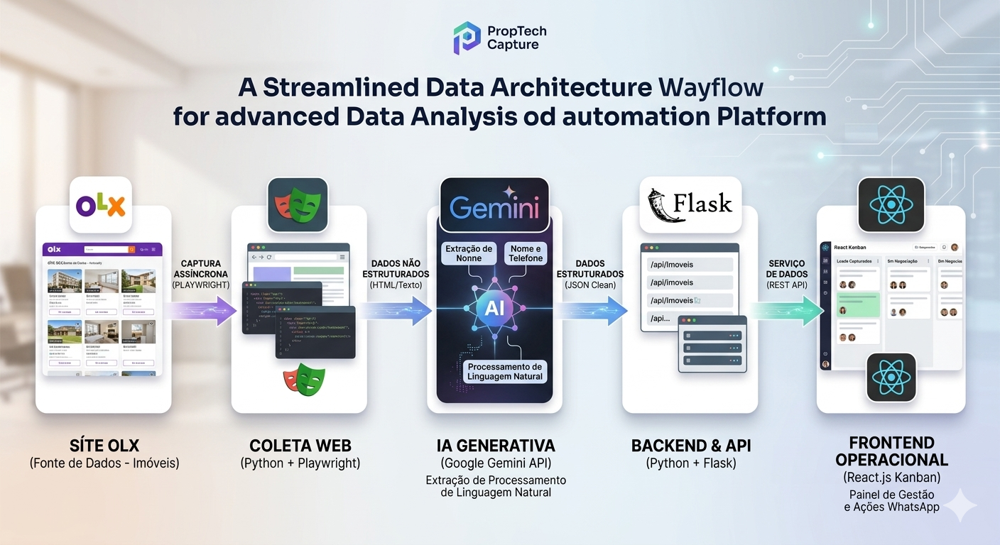

# PropTech Capture

Sistema que encontra anúncios de imóveis publicados **direto pelo proprietário** na OLX, organiza os dados com IA e mostra os contatos em um painel Kanban para corretores.



## O problema

Corretores perdem horas procurando, um por um, anúncios de proprietários particulares. O PropTech Capture automatiza a busca, extrai nome e contato com IA e entrega uma lista pronta para abordagem.

## Como funciona

```text
OLX  ->  capturador.py (Playwright + Gemini)  ->  imoveis.json
                                                      |
                     Painel React (Kanban)  <-  servidor.py (Flask API)
```

1. **Coleta (`capturador.py`)**: o Playwright abre a listagem da OLX e reúne os links dos anúncios.
2. **Estruturação com IA**: o Gemini lê cada anúncio e devolve nome e WhatsApp em JSON. Se a API falhar ou estiver sem saldo, um modo local registra o anúncio com dados padrão.
3. **API local (`servidor.py`)**: o Flask serve os dados em `GET /api/imoveis` e grava contatos sem WhatsApp em `POST /api/backlog`.
4. **Painel (`src/App.js`)**: Kanban com as colunas Captado, Contatado, Em Negociação e Cadastrado. Permite copiar a mensagem, abrir o WhatsApp ou descartar o card.

## Tecnologias

- **Python 3**: Playwright (async), Flask, Flask-CORS, Google Gen AI SDK, python-dotenv
- **JavaScript**: React (Hooks)
- **IA**: Gemini API

## Estrutura

```text
proptech-capture/
├── capturador.py          # robô de coleta + IA
├── servidor.py            # API local Flask (porta 5000)
├── imoveis.exemplo.json   # dados fictícios de exemplo
├── .env.example           # modelo de configuração
└── src/
    ├── App.js             # painel Kanban
    └── App.css            # estilos responsivos
```

## Como rodar

### 1. Pré-requisitos
- Python 3.10+
- Node.js 18+
- Uma chave da Gemini API (https://aistudio.google.com/apikey)

### 2. Instalação
```bash
git clone https://github.com/aldoxiv/proptech-capture.git
cd proptech-capture

pip install playwright flask flask-cors google-genai python-dotenv
playwright install chromium

npm install
```

### 3. Configuração
```bash
cp .env.example .env
```
Abra o `.env` e coloque a sua chave em `GEMINI_API_KEY`. Esse arquivo nunca vai para o GitHub.

Para testar o painel sem rodar o robô, copie os dados de exemplo:
```bash
cp imoveis.exemplo.json imoveis.json
```

### 4. Execução (três terminais)
```bash
python servidor.py      # API em http://127.0.0.1:5000
python capturador.py    # coleta novos anúncios
npm start               # painel em http://localhost:3000
```

## Limitações conhecidas

- O bairro está fixo como "Vila Prudente" no código.
- A coleta está limitada aos 5 primeiros anúncios, para testes rápidos.
- A mudança de coluna no Kanban ainda não é salva.
- Mudanças no site da OLX podem quebrar os seletores.

## Próximos passos

- [ ] Filtros de bairro e tipo de imóvel por configuração
- [ ] Arrastar cards entre colunas e salvar o status
- [ ] Trocar o JSON por um banco SQLite
- [ ] Evitar anúncios repetidos entre execuções
- [ ] Testes automatizados (pytest) para o parser da IA e a API
- [ ] Agendamento automático da coleta
- [ ] Novas fontes além da OLX

## Uso responsável

Projeto de estudo e portfólio. Respeite os Termos de Uso dos sites consultados e a LGPD ao tratar dados de contato. Os dados deste repositório são fictícios.

## Autor

Aldo Santos - [Portfólio](https://aldo-santos.lovable.app/) - [GitHub](https://github.com/aldoxiv)
